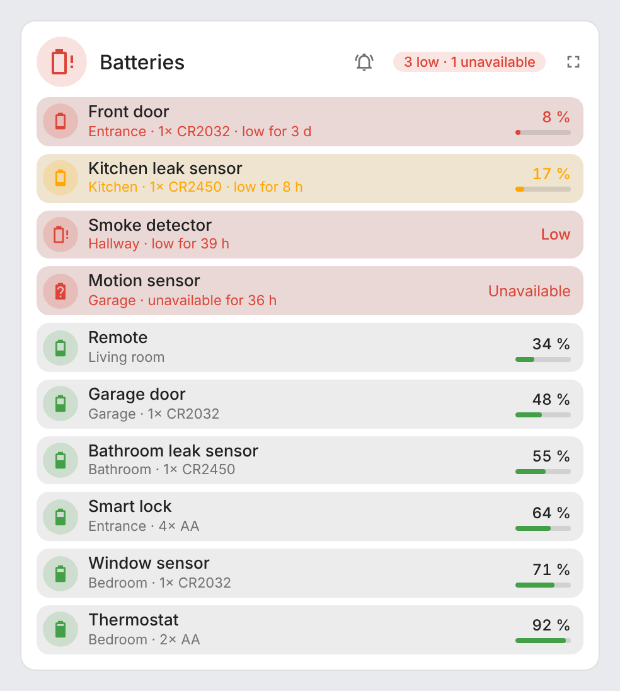
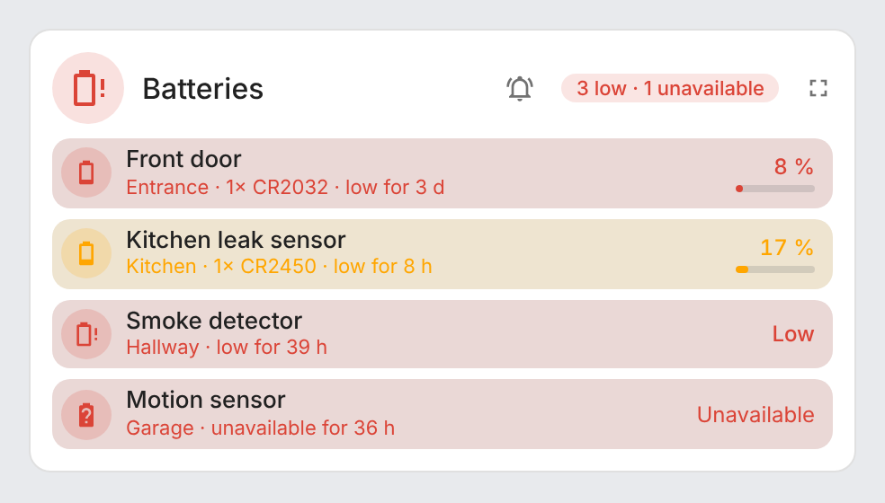
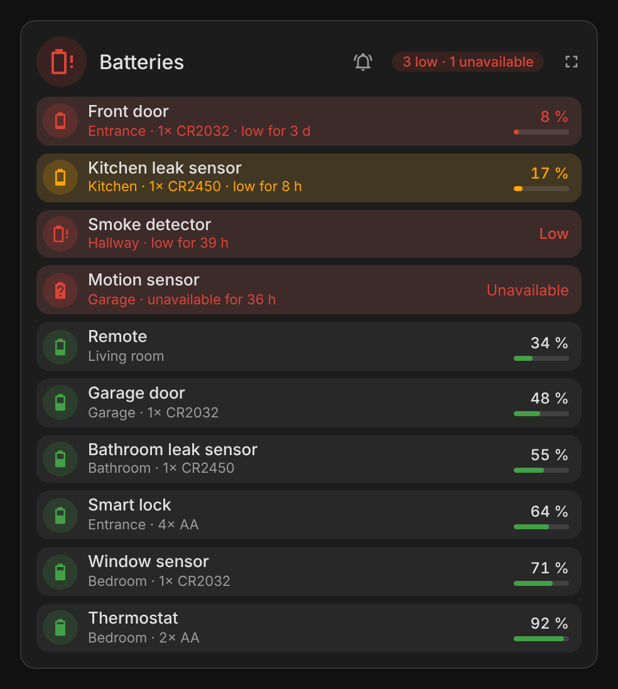
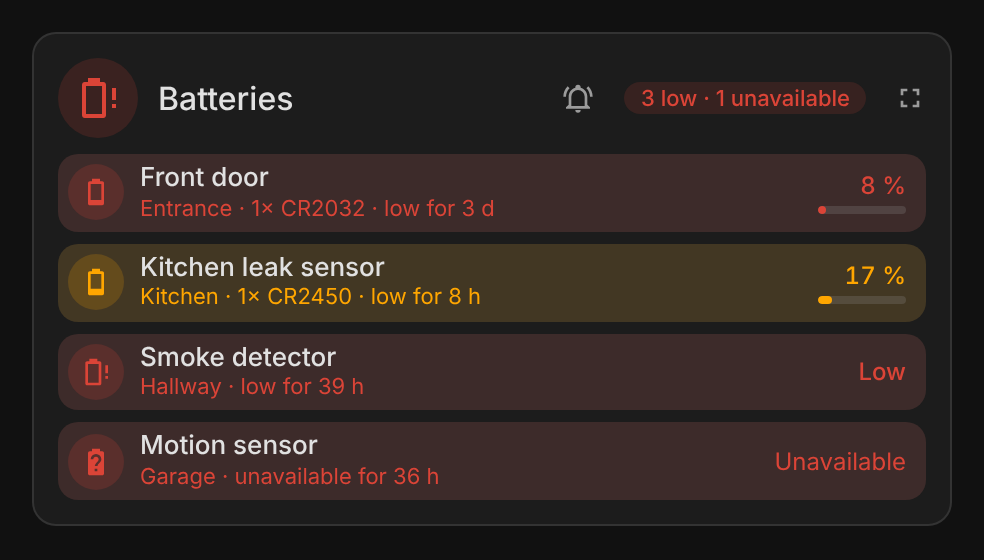
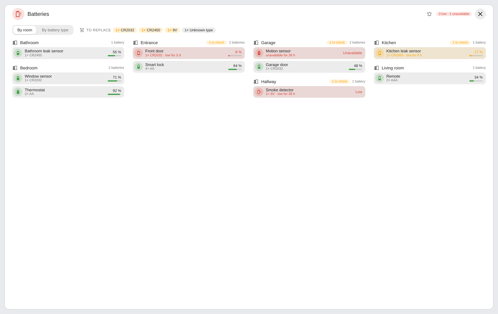
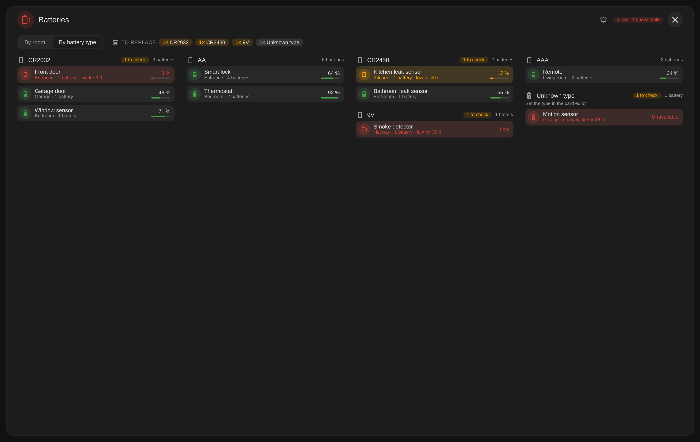
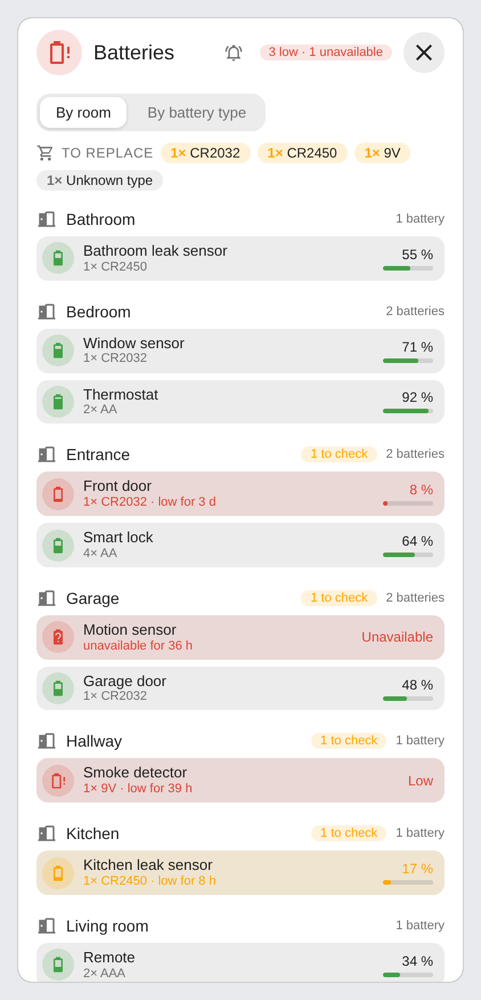
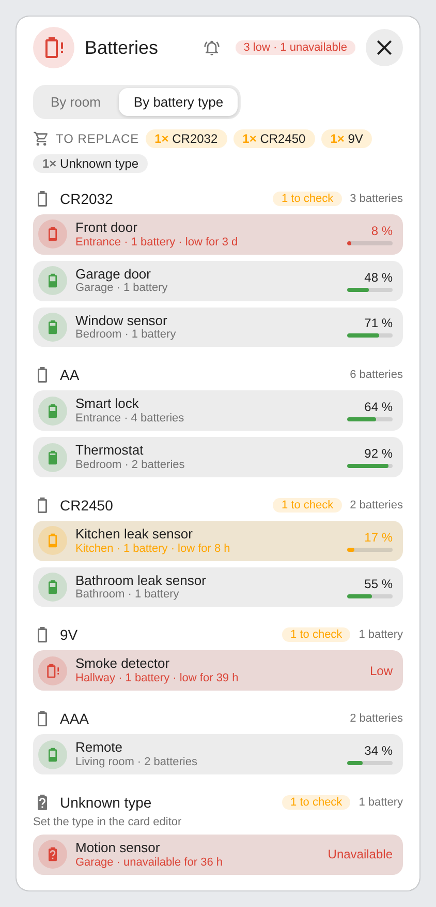

# ha-battery-monitor

[](https://github.com/hacs/integration)
[](https://github.com/juju35/ha-battery-monitor/actions/workflows/hacs.yml)
[](https://github.com/juju35/ha-battery-monitor/actions/workflows/validate.yml)
[](https://github.com/juju35/ha-battery-monitor/releases/latest)
[](LICENSE)

<p align="center">
  <picture>
    <source media="(prefers-color-scheme: dark)" srcset="custom_components/battery_monitor/brand/dark_logo.png">
    
  </picture>
</p>

Home Assistant integration that watches every battery of your home and tells you, **twice a day**, which devices have stayed **below a threshold for a while**: no more alerts for a battery that dips for an hour, no more dead sensor you find out about a week later.

It comes with a **Lovelace card** listing every battery with its icon, name, room and level, the lowest first.

[](https://my.home-assistant.io/redirect/hacs_repository/?owner=juju35&repository=ha-battery-monitor&category=integration)

| Every battery | Low batteries only |
|---|---|
|  |  |

## Features

- **Automatic discovery** of every battery: `sensor` (level in %) and `binary_sensor` (low / normal) with the `battery` device class, one per device
- **Threshold** (20 % by default) and **duration** (24 hours by default): a battery is notified once it has stayed below the threshold for that long, even across restarts
- **Unavailable batteries** reported too: a device whose battery is `unavailable` or `unknown` for the duration (often a dead battery) is notified like a low one
- **Two notifications a day**, at times you choose (09:00 and 19:00 by default), listing the low batteries with their room and level
- **Persistent notification**, replaced each time and cleared when no battery is low any more, and the **notify actions** of your choice (mobile app…)
- **Ignored batteries and integrations**: phones and tablets of the mobile app are left out by default
- **Lovelace card bundled with the integration**, added automatically to the dashboard resources (nothing to add by hand): icon, name, room, battery type, level and how long the battery has been low; only the batteries needing attention are tinted: orange while low, red when unavailable or once notified (blinking once notified)
- **Full screen view** from the card: every battery grouped **by room** or **by battery type** (CR2032, AA…), with what to buy for the ones to replace; battery types read from [Battery Notes](https://github.com/andrew-codechimp/HA-Battery-Notes) or set in the card editor
- **Low batteries** sensor with every monitored battery in its attributes, **Last notification** sensor, **Notify now** button and `battery_monitor.notify` action
- UI setup, no YAML; English and French

## Prerequisites

- Home Assistant 2024.12 or newer
- Devices that report their battery (Zigbee, Z-Wave, Bluetooth, Matter…), with the `battery` device class

## Installation

### Via HACS (recommended)

[](https://my.home-assistant.io/redirect/hacs_repository/?owner=juju35&repository=ha-battery-monitor&category=integration)

Or manually:

1. Open HACS → **⋮** → **Custom repositories**
2. Add `https://github.com/juju35/ha-battery-monitor` — Type: **Integration**
3. Search for **Battery Monitor** and download it
4. Restart Home Assistant

### Manual

1. Download `battery_monitor.zip` from the [latest release](https://github.com/juju35/ha-battery-monitor/releases/latest)
2. Unzip it into `/config/custom_components/battery_monitor/`
3. Restart Home Assistant

### Removal

Remove the integration from **Settings → Devices & services**: its notification and the card resource are removed with it. Then remove the repository from HACS.

## Configuration

**Settings → Devices & services → Add integration → Battery Monitor.** Everything can be changed later with **Configure**.

| Option | Default | Description |
|---|---|---|
| Low battery threshold | `20` % | A battery is low below this level |
| Low for at least | `24` h | Hours a battery must have stayed below the threshold before it is notified (`0`: at the next notification) |
| Morning notification | `09:00` | First of the two daily notifications |
| Evening notification | `19:00` | Second of the two daily notifications |
| Notify actions | — | Also send the notifications with these actions (`notify.mobile_app_…`); a persistent notification is always created |
| Ignored batteries | — | Batteries never monitored |
| Ignored integrations | `mobile_app` | Integrations whose batteries are never monitored |

### Notifications

At each notification time, the batteries that have been below the threshold for the duration are listed, the lowest first:

```text
3 low batteries
• Front door (Entrance): 8 %
• Kitchen leak sensor (Kitchen): 17 %
• Smoke detector (Hallway): low
```

As soon as one of them is unavailable, the title becomes *N batteries to check* and its line says *unavailable*.

When no battery is due, nothing is sent and the persistent notification is cleared.

### Entities

| Entity | Description |
|---|---|
| `sensor.battery_monitor_low_batteries` | Number of batteries below the threshold. Attributes: `unavailable` (number of unavailable batteries), `due` (number needing attention for the duration), `threshold`, `duration` (h), `batteries` (every monitored battery: `entity_id`, `device_id`, `name`, `area`, `level`, `icon`, `low`, `alert` (low or unavailable), `due`, `unavailable`, `below_since`) |
| `sensor.battery_monitor_last_notification` | Time of the last notification; attribute `notified` (number of batteries notified) |
| `button.battery_monitor_notify_now` | Sends every low battery right away, whatever the duration (or *No low battery*) |

### Action `battery_monitor.notify`

Sends every battery below the threshold right away, whatever the duration, or a *No low battery* message when none is low (the scheduled notifications only list the batteries low for the duration). For example from an automation when you leave on holiday:

```yaml
action: battery_monitor.notify
```

### Card

The card is added to the dashboard resources by the integration. Add it from the dashboard (**Add card → Battery Monitor Card**) or in YAML:

```yaml
type: custom:battery-monitor-card
```

| Option | Default | Description |
|---|---|---|
| `entity` | Auto | The **Low batteries** sensor; found automatically |
| `title` | `Batteries` | Card title |
| `columns` | `1` | Number of battery columns (1–3) |
| `only_low` | `false` | Show only the batteries below the threshold or unavailable |
| `hide_when_ok` | `false` | Hide the whole card when every battery is above the threshold and available |
| `notify_button` | `true` | Bell button in the header that sends the notification now |
| `popup` | `true` | Full screen button in the header |
| `battery_models` | — | The battery type of every device of a model Battery Notes doesn't know: `Hue dimmer switch: CR2450`, `Radiator Thermostat W600: 2× AA` |
| `battery_types` | — | The type of one battery, by battery entity, for one without a model or that differs from its model: `sensor.remote_battery: 2× AAA` |
| `language` | Auto | Force language: `fr` or `en` |

Tap a battery to open its details.

#### Full screen

The **full screen** button (top right) shows every battery over the whole screen, grouped **by room** or **by battery type**, with **To replace**: how many batteries of each type to buy for the ones low or unavailable. It closes with its button, Escape, a click outside, or the back button on a phone. On a phone the groups follow one another; wider, they sit side by side in balanced columns.

The battery type comes from [Battery Notes](https://github.com/andrew-codechimp/HA-Battery-Notes) when it is installed (the `battery_type` and `battery_quantity` of the battery, or its device's *Battery type* sensor). For the others, set it once per **device model**: the card editor's **Battery types by model** section lists the models (with their manufacturer and how many devices) whose type is not detected; pick a type (CR2032, CR2450, AA, AAA, 2× AA, 9V, built-in rechargeable…) or type your own. A battery without a model, or one that differs from its model, gets its own type in **Battery types by battery**, which wins over its model. `2× AA` (or `2x AA`, `AA x2`) counts two batteries; the batteries without a type are grouped under **Unknown type**. The order: the battery's own type, then its model's, then Battery Notes.

```yaml
type: custom:battery-monitor-card
battery_models:
  Hue dimmer switch: CR2450
  MYGGBETT door/window sensor: AAA
  Radiator Thermostat W600: 2× AA
battery_types:
  sensor.remote_battery: 2× AAA
```

## Screenshots

| Every battery | Low batteries only |
|---|---|
|  |  |
|  |  |

| Full screen, by room | Full screen, by battery type (dark) |
|---|---|
|  |  |
|  |  |

## How it works

A battery is a `sensor` with the `battery` device class (its level in %) or a `binary_sensor` with the `battery` device class (`on` means low). When a device has both, its level sensor is used. Hidden entities, the ignored batteries and the batteries of the ignored integrations are left out.

When a battery goes below the threshold, Battery Monitor writes down the time. For a battery that is already low when it is first seen (right after installing Battery Monitor, say), that time is read from the history, up to 30 days back. It is kept while the battery is unavailable (a dead battery often makes its device unavailable) and across restarts, and forgotten once the battery is back above the threshold (replaced or recharged). A battery is notified once that time is older than the duration.

The list is updated whenever a battery changes, and every 10 minutes.

## Development

```bash
pip install -r requirements_test.txt && pytest
python scripts/screenshots.py  # renders the card with mock batteries into screenshots/
```

### Releasing

1. Bump the version in `custom_components/battery_monitor/manifest.json`, `const.py` (`VERSION`) and the card (`BATTERY_MONITOR_CARD_VERSION`)
2. Add a `## <version>` section at the top of [CHANGELOG.md](CHANGELOG.md)
3. Push to `main`: the **Release** workflow creates the tag and the GitHub release with the changelog section as notes, and attaches `battery_monitor.zip`

## Translations

The integration and the card follow the language of Home Assistant. Currently supported:

| Language | Code |
|---|---|
| English | `en` |
| Français | `fr` |

Contributions for additional languages are welcome!

## License

[MIT](LICENSE)
