# ha-battery-monitor

[](https://www.home-assistant.io/integrations/marketplace/)
[](https://github.com/juju35/ha-battery-monitor/actions/workflows/hacs.yml)
[](https://github.com/juju35/ha-battery-monitor/actions/workflows/validate.yml)
[](https://github.com/juju35/ha-battery-monitor/actions/workflows/lint.yml)
[](https://github.com/juju35/ha-battery-monitor/releases/latest)
[](https://github.com/juju35/ha-battery-monitor/blob/main/LICENSE)
[](https://buymeacoffee.com/julienstep9)

<p align="center">
  <picture>
    <source media="(prefers-color-scheme: dark)" srcset="https://raw.githubusercontent.com/juju35/ha-battery-monitor/main/custom_components/battery_monitor/brand/dark_logo.png">
    
  </picture>
</p>

Home Assistant integration that watches every battery of your home and tells you, **twice a day**, which devices have stayed **below a threshold for a while**: no more alerts for a battery that dips for an hour, no more dead sensor you find out about a week later.

It comes with a **Lovelace card** listing every battery with its icon, name, room and level, the lowest first.

[](https://my.home-assistant.io/redirect/marketplace_repository/?owner=juju35&repository=ha-battery-monitor&category=integration)

| Every battery | Low batteries only |
|---|---|
| 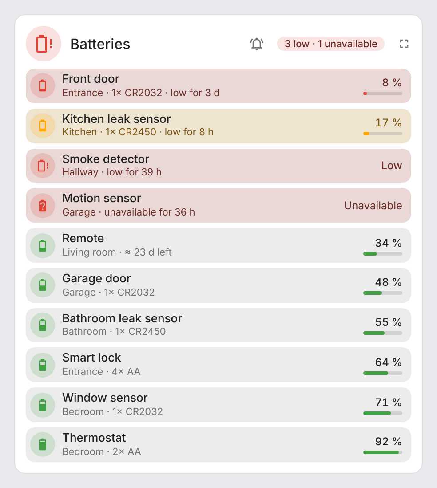 | 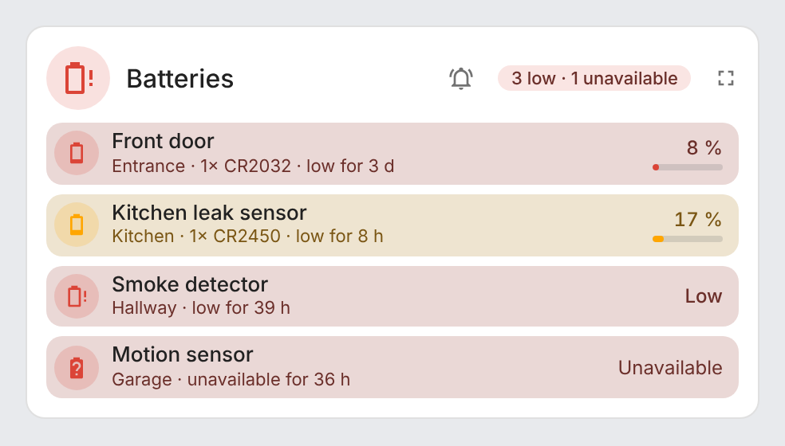 |

## Features

- **Automatic discovery** of every battery: `sensor` (level in %) and `binary_sensor` (low / normal) with the `battery` device class, one per device
- **Threshold** (20 % by default) and **duration** (24 hours by default): a battery is notified once it has stayed below the threshold for that long, even across restarts
- **Unavailable batteries** reported too: a device whose battery is `unavailable` or `unknown` for the duration (often a dead battery) is notified like a low one
- **Two notifications a day**, at times you choose (09:00 and 19:00 by default), listing the low batteries with their room and level
- **Persistent notification**, replaced each time and cleared when no battery is low any more, and the **notify actions** of your choice (mobile app…)
- **Ignored batteries and integrations**: phones and tablets of the mobile app are left out by default
- **Lovelace card bundled with the integration**, added automatically to the dashboard resources (nothing to add by hand): icon, name, room, battery type, level and how long the battery has been low; only the batteries needing attention are tinted: orange while low, red when unavailable or once notified (blinking once notified)
- **Full screen view** from the card: every battery grouped **by room**, **by battery type** (CR2032, AA…) or **by replacement date** (forecast from the measured drain), with what to buy for the ones to replace, the next replacement and a CSV export; battery types read from [Battery Notes](https://github.com/andrew-codechimp/HA-Battery-Notes) or set in the card editor
- **Replacement forecast**: the drain of each level battery is measured once a day on its recorded history (last 30 days, since the last replacement), and kept across restarts (the history is read again only once the last measure is a day old); the card shows *≈ 12 d left* when the threshold is less than two months away, and the **Next replacement** sensor gives the date the first battery reaches it
- **Events** for your automations: `battery_monitor_low` when a battery goes below the threshold, `battery_monitor_replaced` when a new battery is detected
- **Mini card**: the status and only the batteries needing attention, with a button that shows the full card
- **Low batteries** sensor with every monitored battery in its attributes, **Last notification** and **Next replacement** sensors, **Notify now** button, `battery_monitor.notify` and `battery_monitor.export` (CSV) actions
- UI setup, no YAML; English, French, German, Spanish, Italian, Dutch, European Portuguese, Polish, Romanian, Danish, Swedish, Bulgarian, Russian, Ukrainian, Hungarian, Slovak, Czech, Slovenian, Latvian, Greek and Serbian (Cyrillic and Latin)

## Prerequisites

- Home Assistant 2024.12 or newer
- Devices that report their battery (Zigbee, Z-Wave, Bluetooth, Matter…), with the `battery` device class

## Installation

### Via the Marketplace (recommended)

[](https://my.home-assistant.io/redirect/marketplace_repository/?owner=juju35&repository=ha-battery-monitor&category=integration)

Or manually:

1. Open **Settings → Marketplace → Add from link** (top right; this needs a GitHub account connected)
2. Add `https://github.com/juju35/ha-battery-monitor` — Type: **Integration**
3. Open **Battery Monitor** and click **Install**
4. Restart Home Assistant

### Manual

1. Download `battery_monitor.zip` from the [latest release](https://github.com/juju35/ha-battery-monitor/releases/latest)
2. Unzip it into `/config/custom_components/battery_monitor/`
3. Restart Home Assistant

### Removal

Remove the integration from **Settings → Devices & services**: its notification and the card resource are removed with it. Then uninstall the repository in **Settings → Marketplace**.

## Configuration

**Settings → Devices & services → Add integration → Battery Monitor.** Everything can be changed later with **Configure**.

| Option | Default | Description |
|---|---|---|
| Low battery threshold | `20` % | A battery is low below this level |
| Low for at least | `24` h | Hours a battery must have stayed below the threshold before it is notified (`0`: at the next notification) |
| Morning notification | `09:00` | First of the two daily notifications |
| Evening notification | `19:00` | Second of the two daily notifications |
| Notify actions | — | Also send the notifications with these actions (`notify.mobile_app_…`); a persistent notification is always created |
| Ignored batteries | — | Batteries never monitored |
| Ignored integrations | `mobile_app` | Integrations whose batteries are never monitored |

### Notifications

At each notification time, the batteries that have been below the threshold for the duration are listed, the lowest first:

```text
3 low batteries
• Front door (Entrance): 8 % · CR2032
• Kitchen leak sensor (Kitchen): 17 % · 2× AAA
• Smoke detector (Hallway): low
```

As soon as one of them is unavailable, the title becomes *N batteries to check* and its line says *unavailable*. The battery type ends the line when [Battery Notes](https://github.com/andrew-codechimp/HA-Battery-Notes) knows it (the `battery_type` and `battery_quantity` of the battery, or its device's *Battery type* sensor).

When no battery is due, nothing is sent and the persistent notification is cleared.

### Entities

| Entity | Description |
|---|---|
| `sensor.battery_monitor_low_batteries` | Number of batteries below the threshold. Attributes: `unavailable` (number of unavailable batteries), `due` (number needing attention for the duration), `threshold`, `duration` (h), `batteries` (every monitored battery: `entity_id`, `device_id`, `name`, `area`, `level`, `icon`, `low`, `alert` (low or unavailable), `due`, `unavailable`, `below_since`, `drain_per_day` (% per day measured on the history, `0` when stable, `null` when unknown), `days_left` (before the threshold, `null` when stable, unknown, or already low or unavailable), `replace_by` (that date), `battery_type` (from Battery Notes, `2× AA`, `null` when unknown)) |
| `sensor.battery_monitor_last_notification` | Time of the last notification; attribute `notified` (number of batteries notified) |
| `sensor.battery_monitor_next_replacement` | Date the first battery is forecast to reach the threshold; a battery already low or unavailable comes first (since when it has been). Attributes: `entity_id`, `name`, `level`, `days_left` (`0` for one already low), `forecast_at` (last measure of the drains) |
| `button.battery_monitor_notify_now` | Sends every low battery right away, whatever the duration (or *No low battery*) |

### Action `battery_monitor.notify`

Sends every battery below the threshold right away, whatever the duration, or a *No low battery* message when none is low (the scheduled notifications only list the batteries low for the duration). For example from an automation when you leave on holiday:

```yaml
action: battery_monitor.notify
```

### Action `battery_monitor.export`

Writes every monitored battery to a CSV file (`entity_id`, `name`, `area`, `level`, `low`, `unavailable`, `due`, `below_since`, `drain_per_day`, `days_left`, `replace_by`, `battery_type` (from Battery Notes)), for a spreadsheet or a report. Administrators only. `path` is optional: `battery_monitor.csv` in the configuration folder by default; a relative path is inside the configuration folder, an absolute one must be in the configuration folder or in `allowlist_external_dirs`. The file name must end in `.csv`, and hidden folders such as `.storage` are refused. Returns the path and the number of batteries.

```yaml
action: battery_monitor.export
data:
  path: exports/batteries.csv
response_variable: result  # {"path": "/config/exports/batteries.csv", "batteries": 23}
```

### Events

Battery Monitor fires two events on the Home Assistant bus, on a change only (never for a battery already low at start-up, after a reload or when first found):

| Event | When | Data |
|---|---|---|
| `battery_monitor_low` | A battery goes below the threshold (or a low-battery binary sensor turns `on`); a battery that goes unavailable and comes back still low does not fire it again | `entry_id`, `entity_id`, `device_id`, `name`, `level` (`null` for a binary sensor), `threshold` |
| `battery_monitor_replaced` | A battery's level rises by 15 points or more since its last reading (the same rule that restarts the replacement forecast), even with an unavailable gap while the battery was out | `entry_id`, `entity_id`, `device_id`, `name`, `level`, `previous_level` |

For example, a notification on your phone as soon as a battery goes low, and a logbook entry when one is replaced:

```yaml
automation:
  - alias: Battery low
    triggers:
      - trigger: event
        event_type: battery_monitor_low
    actions:
      - action: notify.mobile_app_phone
        data:
          title: Low battery
          message: "{{ trigger.event.data.name }}: {{ trigger.event.data.level }} %"
  - alias: Battery replaced
    triggers:
      - trigger: event
        event_type: battery_monitor_replaced
    actions:
      - action: logbook.log
        data:
          name: "{{ trigger.event.data.name }}"
          message: "battery replaced ({{ trigger.event.data.previous_level }} % → {{ trigger.event.data.level }} %)"
          entity_id: "{{ trigger.event.data.entity_id }}"
```

### Diagnostics

**Settings → Devices & services → Battery Monitor → ⋮ → Download diagnostics** gives the options and every monitored battery (level, status, times, forecast), to attach to an issue. The notify actions, which name your phones, are redacted.

### Card

The card is added to the dashboard resources by the integration. Add it from the dashboard (**Add card → Battery Monitor Card**) or in YAML:

```yaml
type: custom:battery-monitor-card
```

| Option | Default | Description |
|---|---|---|
| `entity` | Auto | The **Low batteries** sensor; found automatically |
| `title` | `Batteries` | Card title |
| `columns` | `1` | Number of battery columns (1–3); a card too narrow for them shows fewer, each at least 160 px wide |
| `only_low` | `false` | Show only the batteries below the threshold or unavailable |
| `hide_when_ok` | `false` | Hide the whole card when every battery is above the threshold and available (always shown while editing the dashboard) |
| `notify_button` | `true` | Bell button in the header that sends the notification now: it turns while sending, then shows a check mark, or the reason in its tooltip when it fails; disabled while the button entity is unavailable |
| `popup` | `true` | Full screen button in the header |
| `battery_models` | — | The battery type of every device of a model Battery Notes doesn't know: `Hue dimmer switch: CR2450`, `Radiator Thermostat W600: 2× AA` |
| `battery_types` | — | The type of one battery, by battery entity, for one without a model or that differs from its model: `sensor.remote_battery: 2× AAA` |
| `language` | Auto | Force language: `en`, `fr`, `de`, `es`, `it`, `nl`, `pt` (European Portuguese), `pl`, `ro`, `da`, `sv`, `bg`, `ru`, `uk`, `hu`, `sk`, `cs`, `sl`, `lv`, `el`, `sr` (Serbian, Cyrillic) or `sr-Latn` (Serbian, Latin) |

Tap a battery to open its details.

#### Mini card

A compact card for a half-width column: the header with its status and **Notify now** button, and only the batteries needing attention (nothing more when every battery is fine). The detail button (top right) shows the full card, with every battery and its full screen button; a click outside the card brings the compact view back. Same options and editor as the card (**Add card → Battery Monitor Mini Card**):

```yaml
type: custom:battery-monitor-mini-card
```

#### Full screen

The **full screen** button (top right) shows every battery over the whole screen, grouped **by room**, **by battery type** or **by replacement date**, with **To replace**: how many batteries of each type to buy for the ones low or unavailable, and **Next replacement**: the first battery the measured drain takes to the threshold, with the date. **By replacement date** sorts the batteries into *To replace now*, *Within 30 days*, *Within 3 months*, *Later* and *No forecast yet*, each with its days left, date and drain per day. **Export CSV** downloads every battery (room, type, level, status, drain, days left, replacement date) to the browser. It closes with its button, Escape, a click outside, or the back button on a phone. From the keyboard, the focus goes to its close button, Tab stays inside it, and the focus returns to the full screen button once it is closed. On a phone the groups follow one another; wider, they sit side by side in balanced columns.

The battery type comes from [Battery Notes](https://github.com/andrew-codechimp/HA-Battery-Notes) when it is installed (the `battery_type` and `battery_quantity` of the battery, or its device's *Battery type* sensor). For the others, set it once per **device model**: the card editor's **Battery types by model** section lists the models (with their manufacturer and how many devices) whose type is not detected; pick a type (CR2032, CR2450, AA, AAA, 2× AA, 9V, built-in rechargeable…) or type your own. A battery without a model, or one that differs from its model, gets its own type in **Battery types by battery**, which wins over its model. `2× AA` (or `2x AA`, `AA x2`) counts two batteries; the batteries without a type are grouped under **Unknown type**. The order: the battery's own type, then its model's, then Battery Notes.

```yaml
type: custom:battery-monitor-card
battery_models:
  Hue dimmer switch: CR2450
  MYGGBETT door/window sensor: AAA
  Radiator Thermostat W600: 2× AA
battery_types:
  sensor.remote_battery: 2× AAA
```

## Screenshots

When a battery is due for replacement, the card animates: its row icon blinks for attention. The rest of the card stays still (and it honours `prefers-reduced-motion`).

| Light | Dark |
|---|---|
| 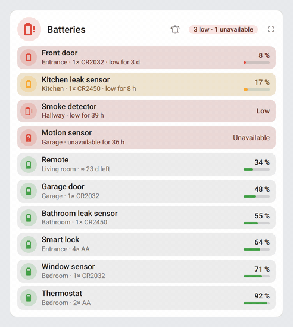 | 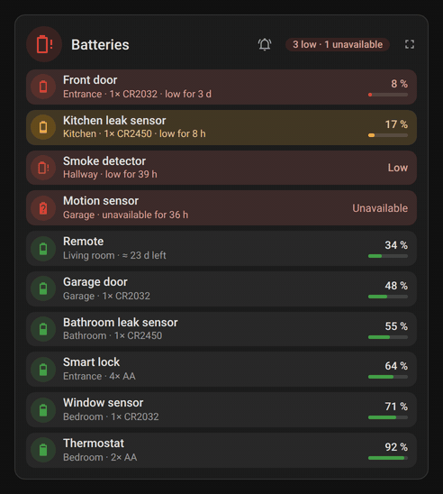 |

| Every battery | Low batteries only |
|---|---|
|  |  |
| 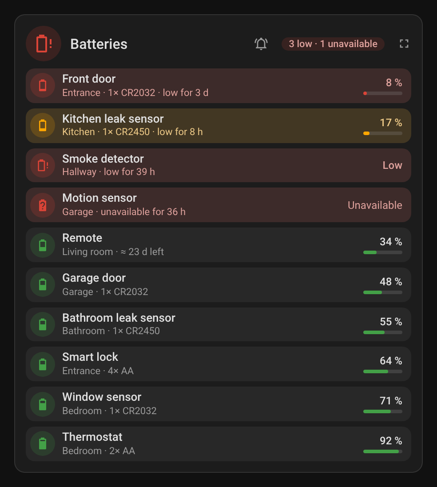 | 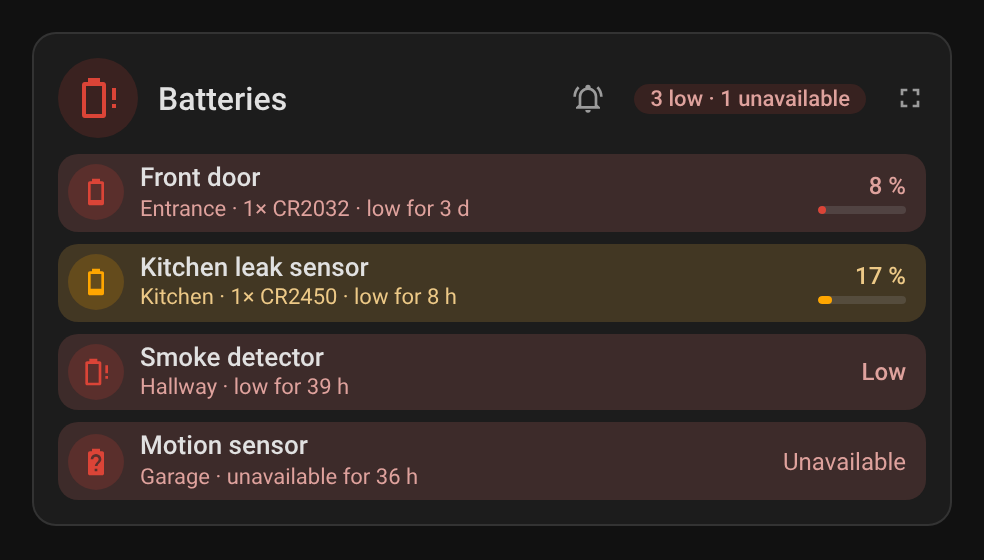 |

| Mini card | Dark |
|---|---|
| 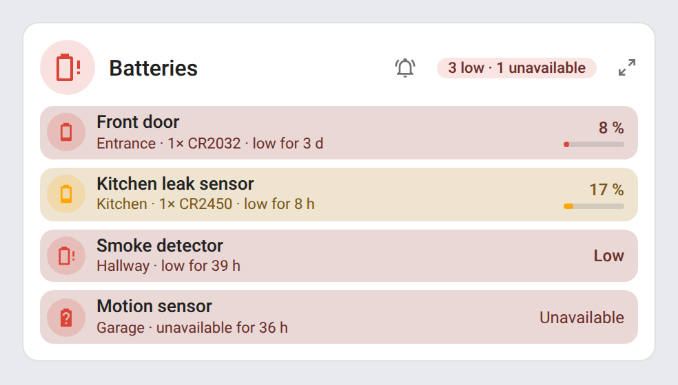 |  |

| Full screen, by replacement date | Dark |
|---|---|
| 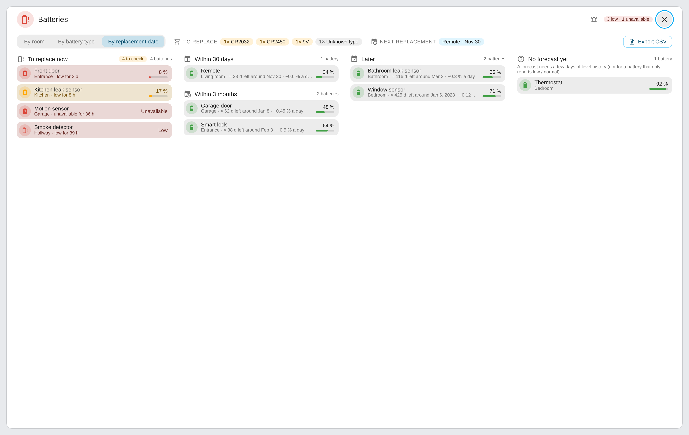 | 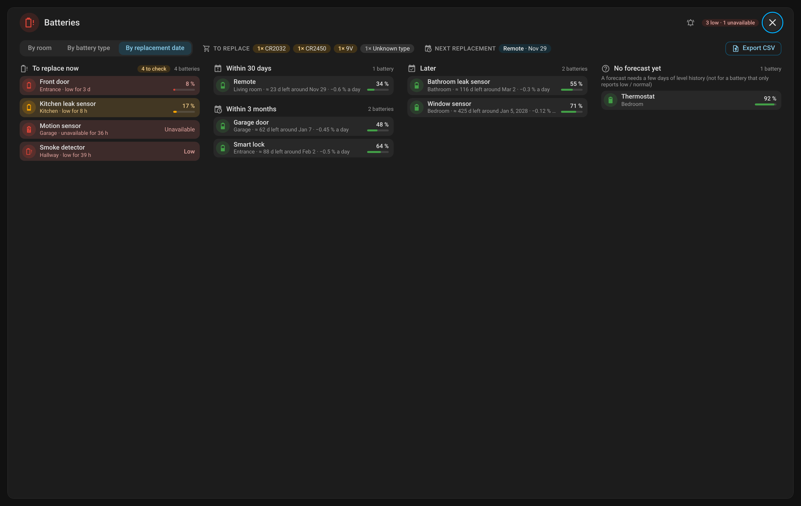 |

| Full screen, by room | Full screen, by battery type |
|---|---|
| 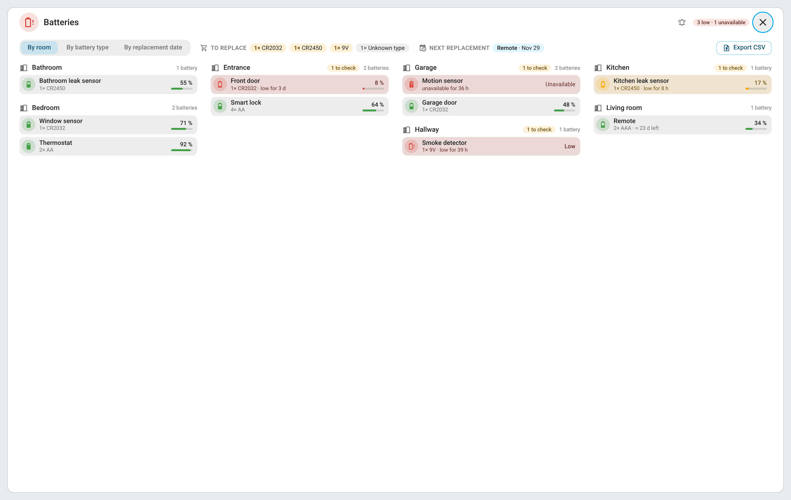 | 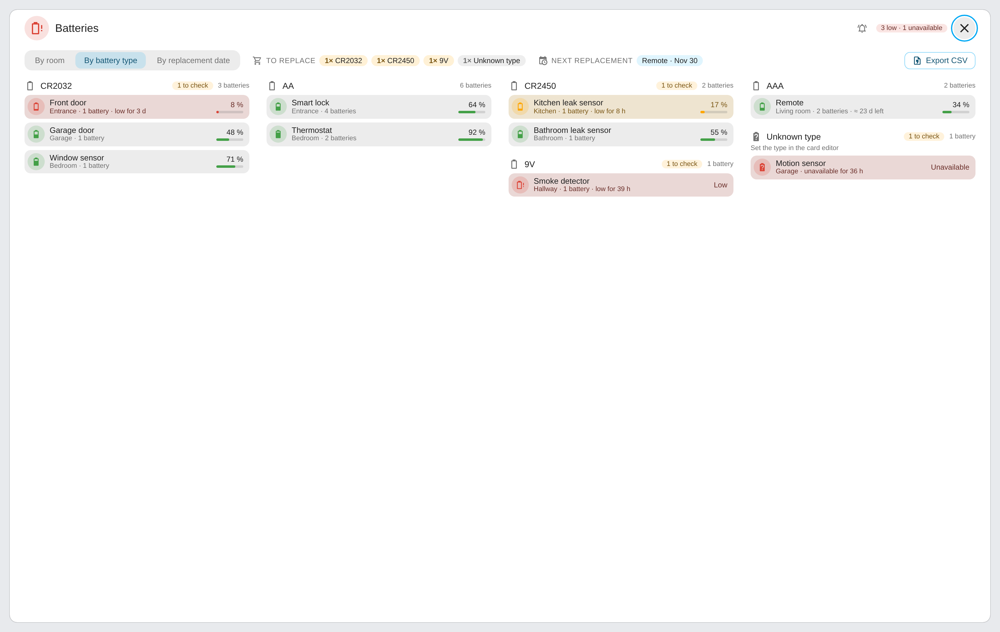 |
| 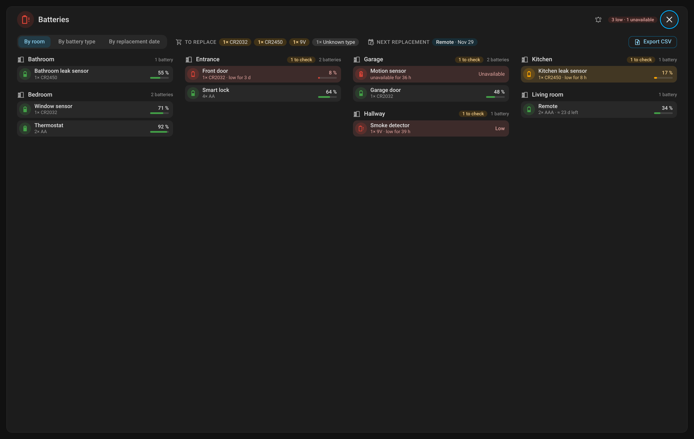 | 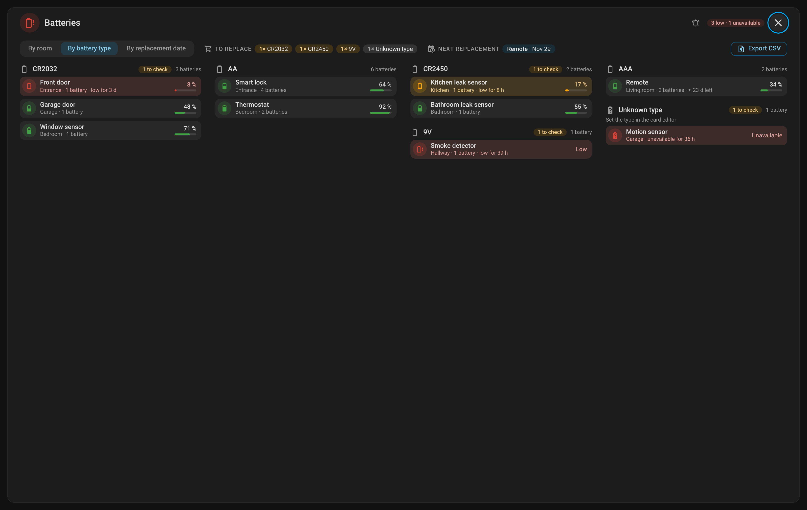 |

| Phone, by room | Phone, by battery type |
|---|---|
| 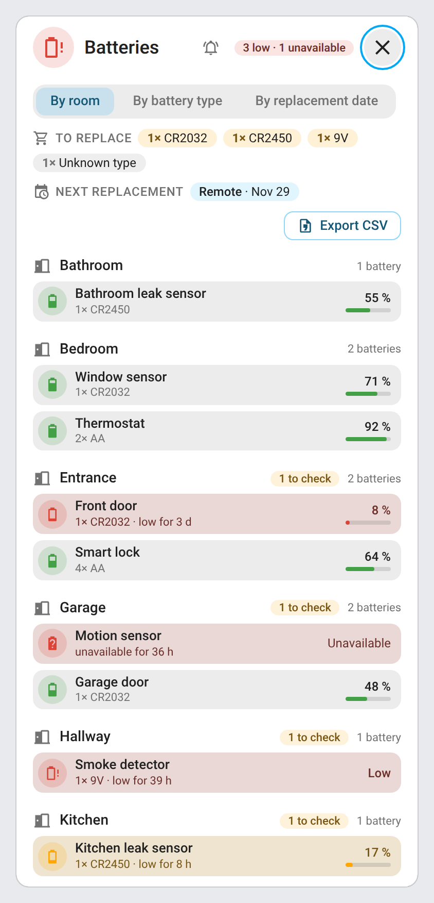 | 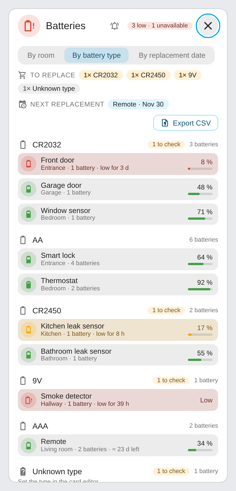 |
| 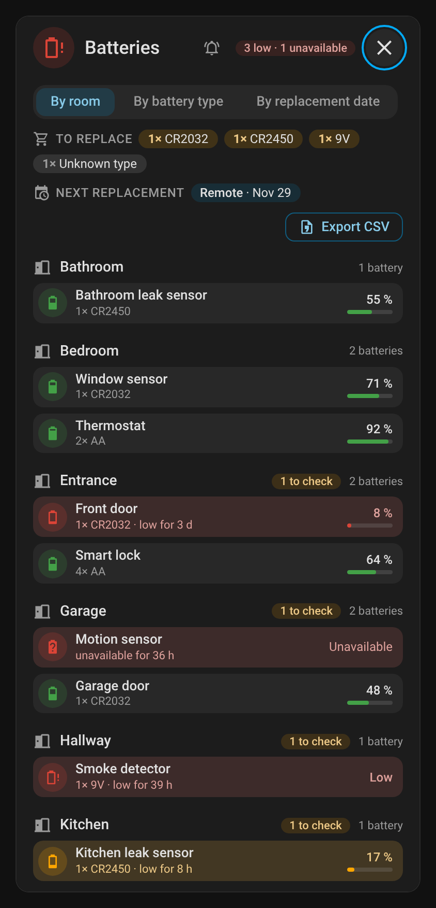 | 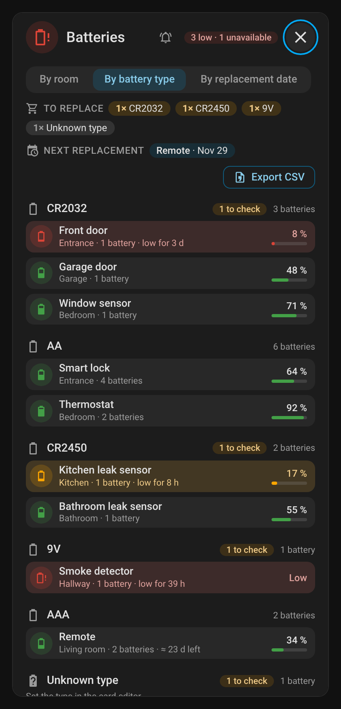 |

## How it works

A battery is a `sensor` with the `battery` device class (its level in %) or a `binary_sensor` with the `battery` device class (`on` means low). When a device has both, its level sensor is used. Hidden entities, the ignored batteries and the batteries of the ignored integrations are left out.

When a battery goes below the threshold, Battery Monitor writes down the time. For a battery that is already low when it is first seen (right after installing Battery Monitor, say), that time is read from the history, up to 30 days back. It is kept while the battery is unavailable (a dead battery often makes its device unavailable) and across restarts, and forgotten once the battery is back above the threshold (replaced or recharged). A battery is notified once that time is older than the duration.

The list is updated whenever a battery changes, and every 10 minutes.

Once a day (and at start), the drain of each level battery is measured on its recorded history over the last 30 days: a least-squares slope of the level, counted from the last replacement (a rise of 15 points or more), when at least three days and three points are recorded. From that drain and the current level come the days left before the threshold and the replacement date; a stable level (less than 0.05 % a day) gives none. The days left follow the level between two measures.

## Development

```bash
pip install -r requirements_test.txt && pytest
python scripts/screenshots.py  # renders the card with mock batteries into screenshots/ (also makes due.gif and due-dark.gif, needs ffmpeg)
```

### Releasing

1. Bump the version in `custom_components/battery_monitor/manifest.json`, `const.py` (`VERSION`) and the card (`BATTERY_MONITOR_CARD_VERSION`)
2. Add a `## <version>` section at the top of [CHANGELOG.md](https://github.com/juju35/ha-battery-monitor/blob/main/CHANGELOG.md)
3. Push to `main`: the **Release** workflow creates the tag and the GitHub release with the changelog section as notes, and attaches `battery_monitor.zip`

## Translations

The integration and the card follow the language of Home Assistant. Currently supported:

| Language | Code |
|---|---|
| English | `en` |
| Français | `fr` |
| Deutsch | `de` |
| Español | `es` |
| Italiano | `it` |
| Nederlands | `nl` |
| Português (European Portuguese) | `pt` |
| Português (pt-BR uses the European Portuguese texts) | `pt-BR` |
| Polski | `pl` |
| Română | `ro` |
| Dansk | `da` |
| Svenska | `sv` |
| Български | `bg` |
| Русский | `ru` |
| Українська | `uk` |
| Magyar | `hu` |
| Slovenčina | `sk` |
| Čeština | `cs` |
| Slovenščina | `sl` |
| Latviešu | `lv` |
| Ελληνικά | `el` |
| Српски (Serbian, Cyrillic) | `sr` |
| Srpski (Serbian, Latin) | `sr-Latn` |

Contributions for additional languages are welcome!

## License

[MIT](https://github.com/juju35/ha-battery-monitor/blob/main/LICENSE)

## Support

If you find this project useful, you can support its development:

<a href="https://buymeacoffee.com/julienstep9"></a>
